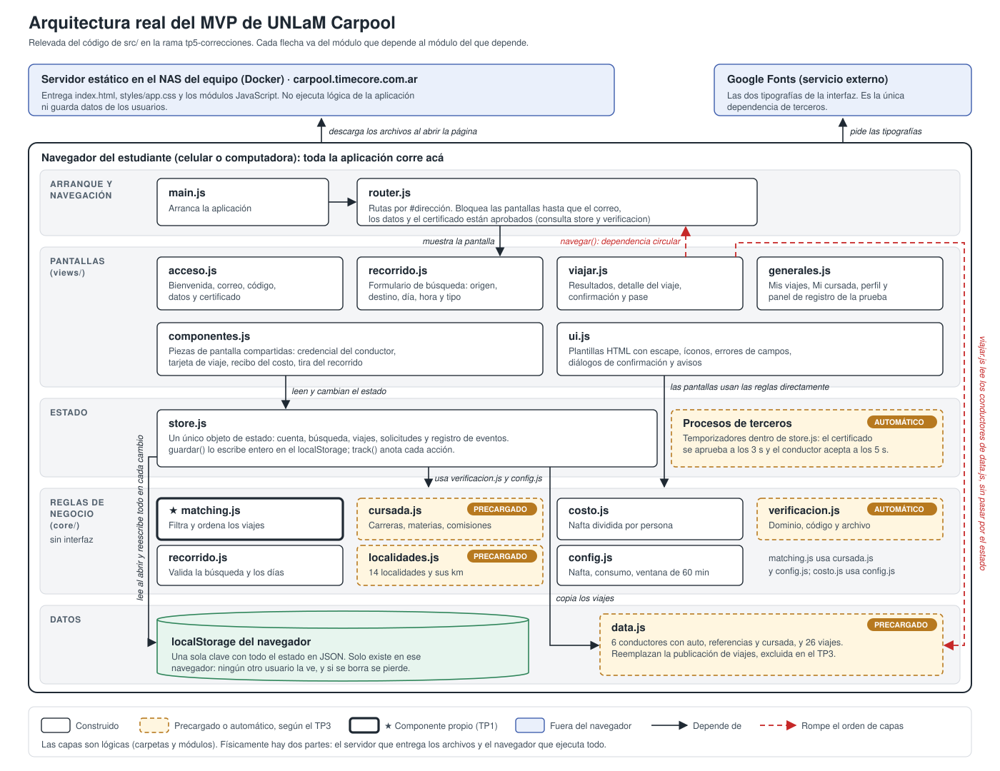
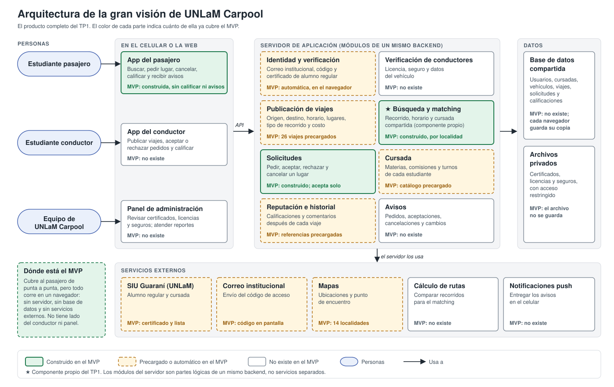

# TP6. Arquitectura del MVP y de la gran visión

**Grupo:** Vertex Consulting Group
**Producto:** UNLaM Carpool
**Repositorio:** https://github.com/gadsii-unlam/gadsii-Vertex (rama `tp6`)
**MVP:** https://carpool.timecore.com.ar
**Archivo de entrega:** `TP6-Vertex.pdf`

## 1. Diagrama de la arquitectura real del MVP

El diagrama sale de leer los 17 módulos de `src/js` y sus `import`. Muestra la arquitectura como quedó, no como nos gustaría que fuera.

**Capas físicas.** Son dos. El NAS del equipo, con Docker, entrega los archivos como un sitio estático y no ejecuta nada. El navegador del estudiante descarga esos archivos y corre toda la aplicación. La única dependencia externa es Google Fonts, para las tipografías.

**Capas lógicas, dentro del navegador:**

| Capa | Módulos | Responsabilidad |
| --- | --- | --- |
| Arranque y navegación | `main.js`, `router.js` | Arrancar la aplicación, decidir qué pantalla mostrar según la dirección y no dejar pasar a quien no verificó su correo, sus datos y su certificado |
| Pantallas | `views/` (4 archivos), `componentes.js`, `ui.js` | Armar cada pantalla y responder a lo que toca el usuario |
| Estado | `store.js` | Guardar la cuenta, la búsqueda, los viajes, las solicitudes y un registro de eventos, y correr los procesos automáticos |
| Reglas de negocio | `core/` (7 archivos) | Matching, cursada, costo, validaciones y valores de configuración, sin tocar la interfaz |
| Datos | `data.js` y el `localStorage` | Los viajes y conductores precargados, y el estado guardado |

**Dependencias.** En general van hacia abajo: las pantallas dependen del estado y de las reglas, y el estado depende de las reglas y de los datos. Hay dos que rompen ese orden, marcadas en rojo. Primero, `router.js` importa las pantallas para mostrarlas y las pantallas importan `router.js` para navegar, así que se dependen mutuamente. Segundo, `viajar.js` lee los conductores directo de `data.js`, sin pasar por el estado.

**Datos y persistencia.** No hay base de datos. Todo el estado es un único objeto que `store.js` guarda como JSON en una sola clave del `localStorage`: lo lee al abrir la aplicación y lo reescribe entero en cada cambio. Al iniciar, copia los 26 viajes de `data.js` para poder descontar los lugares. Ese estado existe solo en ese navegador: ningún otro usuario lo ve.

**Construido, precargado y automático, según el TP3.** Están construidos el control de acceso, la búsqueda, el matching, el costo, la carga de la cursada, la solicitud y la cancelación. Lo que el TP3 dejó fuera del alcance está resuelto así:

* **Precargado:** los 6 conductores y los 26 viajes, en lugar de la publicación; las 14 localidades con sus distancias, en lugar de mapas y rutas; y el catálogo de carreras, materias y comisiones, en lugar de SIU Guaraní.
* **Automático:** el código de acceso aparece en pantalla en lugar de llegar por correo, el certificado se aprueba solo a los 3 segundos y el conductor acepta solo a los 5 segundos.

## 2. Las decisiones heredadas

| Decisión | ¿Quién la tomó? | ¿La sostendríamos hoy? | Qué dato del TP2 o del TP5 la sostiene o la contradice |
| --- | --- | --- | --- |
| **No hay servidor: los datos y las verificaciones viven en el `localStorage` de cada navegador** | La herramienta. Figura como decisión de Claude en `docs/arquitectura/mvp.md`, con el argumento de que la prueba era de una persona por vez | Para el MVP, sí. Para el producto, no | **La sostiene** la prueba del TP5: cada sesión fue de un usuario solo, con viajes precargados, y los tres completaron el flujo sin instalar nada. **La contradice** la misma prueba. En T4, la aplicación les dijo a U1 y a U2 que le avisaría al conductor de la cancelación, y U1 preguntó si tenía que avisarle por su cuenta: con esta arquitectura, ese aviso no le llega a nadie. Además, U1 y U2 dejaron un contacto para que les avisemos cuando haya viajes reales, algo imposible si cada celular tiene sus propios datos |
| **HTML, CSS y JavaScript sin framework ni dependencias**, con el router, las plantillas y el escape de HTML escritos a mano (`router.js` y `ui.js`) | La herramienta. También figura como decisión de Claude, porque se podía publicar gratis y no había nada que instalar | Para el MVP y la app del pasajero, sí. Para sumar la app del conductor y el panel de administración, habría que revisarla | **Ninguno.** Ningún dato del TP2 ni del TP5 tiene que ver con esta decisión: el motivo registrado es la comodidad de quien construía, no el usuario. El costo aparece al crecer: el router y las plantillas propios los tiene que mantener el equipo, y habría que repetirlos en cada aplicación nueva |

## 3. La arquitectura de la gran visión

**El salto más grande es pasar de una aplicación de un solo lado, aislada en cada celular, a una red de dos lados que comparte el mismo estado.** Hoy el pasajero ve 26 viajes que nadie publicó, y su solicitud y su cancelación no salen de su navegador. En la visión del TP1, lo que publica un conductor lo ve un pasajero desde otro celular, el pedido le llega al conductor y la respuesta vuelve como aviso. Eso exige tres cosas que el MVP no tiene en ninguna capa: un servidor que guarde los datos de todos, la identidad controlada del lado del servidor y no en el navegador, y un canal para avisar. Las integraciones externas (SIU Guaraní, mapas, rutas) son saltos más chicos: se conectan a ese servidor una vez que exista.

## 4. Las tecnologías que agregaría la visión

**PostgreSQL con PostGIS, en un contenedor del NAS del equipo.** Es la base de datos compartida que reemplaza al `localStorage`. La justifican dos restricciones reales. La primera es legal: el certificado de alumno regular, la patente y el teléfono son datos personales protegidos por la Ley 25.326, y tienen que guardarse en un servidor con acceso controlado, no en el navegador. La segunda es la infraestructura que ya existe: el equipo publica el MVP en su NAS con Docker, y PostgreSQL corre en un contenedor más, sin pagar un servicio. PostGIS suma consultas geográficas, para que el matching compare recorridos por coordenadas y no por el nombre de la localidad.

**Notificaciones push web, con la aplicación instalable en el celular.** Las justifica el contexto de uso del TP2: el producto se usa desde el celular, para organizar la ida y la vuelta, y esperar mirando la pantalla en la parada es justo la situación que el TP2 marcó como insegura de noche. La prueba del TP5 lo confirma: U1 y U2 pidieron que les avisemos cuando haya viajes, y U1 preguntó si tenía que avisarle al conductor por su cuenta. Las notificaciones push web llegan al celular con el mismo código web del MVP, sin publicar en las tiendas de aplicaciones.

**Node.js para el servidor de aplicación.** Lo elegimos por familiaridad, y lo declaramos así: el MVP está escrito en JavaScript y el equipo que lo va a mantener conoce ese lenguaje. Como ventaja práctica, las reglas de `core/` no dependen de la interfaz y pueden pasar al servidor sin reescribirse.

## 5. El componente más riesgoso

**El matching (`core/matching.js`), el componente propio del TP1.**

**Es lo que falló en la prueba del TP5.** Ningún usuario se trabó, pero en dos de las tres sesiones el matching devolvió un resultado que no servía:

* **U2 pidió un viaje que llegaba tarde.** Necesitaba estar a las 8:00 y el único viaje que le mostró llegaba a las 8:11. El matching compara solo la hora de salida, con una ventana de 60 minutos, y no sabe a qué hora necesita llegar el pasajero, así que ni lo descartó ni lo advirtió.
* **A U1 le puso primero un viaje que no le servía.** El matching ordena primero a quien comparte cursada, sin mirar el horario. El viaje de Juan Rodríguez, con la etiqueta "Cursan juntos", apareció arriba aunque llegaba a las 19:00 y la clase de U1 empezaba a las 18:30.

En los dos casos, el usuario decidió con la hora de llegada, el dato que el matching no usa. U1 y U2 pidieron poder buscar por "llegar antes de".

**Al crecer, cambian todas sus entradas a la vez.** Los viajes dejan de ser 26 armados para las zonas de tres usuarios y pasan a ser los que publiquen conductores reales; aun con los viajes preparados, U2 tuvo una sola opción. Los recorridos pasan por puntos intermedios que una lista de 14 localidades no representa. La cursada pasa a depender de SIU Guaraní. Y la búsqueda, que hoy recorre todos los viajes en el navegador, tiene que pasar al servidor.

**Si falla, el producto pierde su valor aunque haya conductores:** muestra viajes que no sirven o esconde los que sí. Y no hay un servicio externo que lo reemplace.

**Por qué no la verificación de estudiantes.** También tuvo fricción en el TP5: a U3 el primer archivo le dio "El archivo está vacío", U2 esperó la revisión sin un indicador de progreso y U1 preguntó cuánto tardaba. Pero los tres la completaron sin ayuda. Su riesgo al crecer es de proceso (revisar documentos a mano o conseguir acceso a SIU Guaraní), no de un componente que devuelva resultados equivocados.

## 6. Brief de Producto — versión 5

`docs/brief.md` abre con este párrafo de cambios respecto de la versión 4:

> Se describe la arquitectura del MVP tal como quedó construido y la del producto completo. El MVP es un sitio estático publicado en el NAS del equipo: toda la aplicación corre en el navegador y guarda los datos en el `localStorage` de cada dispositivo, sin servidor ni base de datos. Los viajes, los conductores y el catálogo de cursadas están precargados, y la verificación y la aceptación del conductor son automáticas. El producto completo suma un servidor de aplicación con base de datos compartida, la app del conductor, un panel de administración y cinco servicios externos: SIU Guaraní, correo institucional, mapas, cálculo de rutas y notificaciones push. El salto más grande es pasar de una aplicación aislada en cada celular a una red de dos lados que comparte el mismo estado. Se agregan las tecnologías que sumaría el producto y las restricciones técnicas del contexto, y se identifica el matching como el componente más riesgoso, porque en la prueba del TP5 no tuvo en cuenta la hora de llegada.
